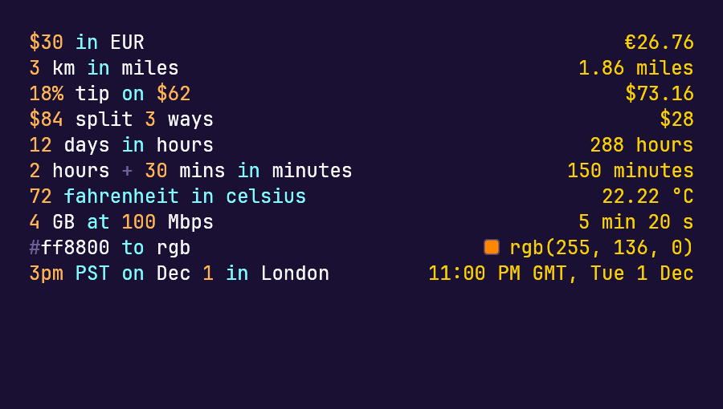

# Calc

A plain-text notes sheet that computes: numbers, units, currencies and dates evaluated on every line as you type. The sheet is ordinary text, so it still reads as a note once you take it out.



## Start it

The flake builds and starts the sheet:

```sh
nix run github:knoopx/calc
```

From a checkout, run `nix run .#calc`, or build once and start the binary it leaves behind:

```sh
nix build .#calc
./result/bin/calc
```

Run it from a graphical Linux session. The package carries its own graphics libraries, so the window opens wherever you start it. It opens on an empty sheet with the caret already in it; there is no file to open first.

To keep the sheet around, add it to your profile. You get a `calc` command and a Calc menu entry with its icon:

```sh
nix profile install github:knoopx/calc
```

On NixOS, or anywhere you keep an overlay, `nixosModules.default` and `overlays.default` both provide the same `calc` package.

To change the sheet, work in its development shell, which holds the Rust toolchain and the libraries the window needs: `nix develop .#rust`, then `cargo run --release`. Builds land in `target/nix`.

## A first sheet

Type each of these on its own line:

```
# Lunch
Pizza $24
Tip: 18% of prev
```

The answers arrive to the right of the line they belong to:

```
# Lunch
Pizza $24           $24
Tip: 18% of prev    $4.32
```

## What a line can say

```
$30 in EUR                          €27
3 km in miles                       1.86 miles
18% tip on $62                      $73.16
$84 split 3 ways                    $28
12 days in hours                    288 hours
2 hours + 30 mins in minutes        150 minutes
72 fahrenheit in celsius            22.22 °C
4 GB at 100 Mbps                    5 min 20 s
#ff8800 in rgb                      rgb(255, 136, 0)
3pm PST on Dec 1 in London          11:00 PM GMT, Tue 1 Dec
```

The same kind of lines in the window, each answered in the right-hand column:

Dates answer as themselves as well: `next friday` names the day that is coming, `days until Dec 25` counts the ones left. Units on the line decide what a number means, so money, durations, speeds, data sizes and colours all stay in their own kind.

A number with a label stays a note: `iPhone 15 $799` answers `$799` rather than multiplying anything.

Name an amount once and use it again on later lines:

```
rate = $85/hour
rate * 6 hours * 4
```

`total`, `sum`, `average`, `mean` gather the lines above them since the last blank line or heading, and `prev` means the answer of the line before.

Start a line with `# ` — a hash, a space, then the words — for a heading, as in `# Lunch`. A hash glued to the next word is ordinary text. `//` marks a note that never computes, and `-`, `1.`, or `- [ ]` make bullets, numbered items, and tasks. All of it stays text around the sums.

## Keys

| Press | To |
| --- | --- |
| `Ctrl` `Space` | ask for names you can use; typing two letters asks on its own |
| `Tab` or `Enter` | insert the highlighted name |
| `Escape` | put the suggestion list away, and keep the caret where it is |
| `F2` | rename the name under the caret everywhere it is used |
| `Ctrl` `C` | copy the selected text |
| `Ctrl` `Shift` `C` | copy the selected lines together with their answers |
| `Ctrl` `Q` or `Ctrl` `W` | close the sheet |

Hover a number to see its value and how many lines use it. Hover a name the sheet doesn't know yet and a dot marks the answer until you sort it out.

## Taking the sheet with you

A bare `Ctrl` `C` copies text, the way you expect it to. Adding `Shift` copies whole lines along with what they compute, answers lined up beside them, ready to paste into a note somewhere else. It takes the lines your selection touches — a partial line goes whole, since its answer belongs to the line — and the whole sheet when nothing is selected. Click a single answer to copy just that figure, and it says "copied" where it stood.

The sheet lives in the window: closing it discards what you typed, so copy it out before you quit.

## When something looks wrong

**An answer is grey.** It is being worked out again, or carried over from the line as it was a moment ago. It settles as you stop typing.

**A note sits where an answer should be.** The line could not be read, and the note says which part gave the trouble.

**A dot instead of an answer.** The line uses a name you have not given a value yet, or spelled differently from the place where you defined it. `F2` fixes the spelling on every line at once.

**No answer at all.** The line is prose. Words without a number to work on are kept as written.

**Currency answers are missing or stale.** Exchange rates arrive over the network while the window is open, from `open.er-api.com`. Without that reachability the rest of the sheet keeps working and conversions do not.

**The window never opens.** Check that you are in a graphical Linux session with working graphics drivers.
